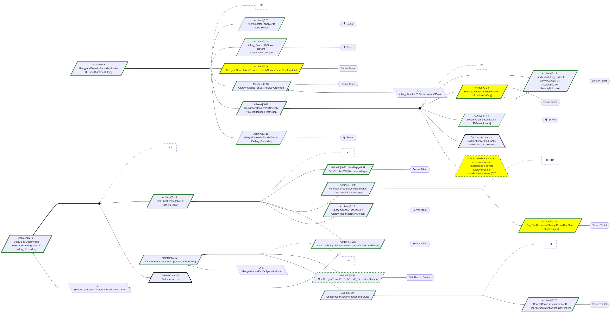
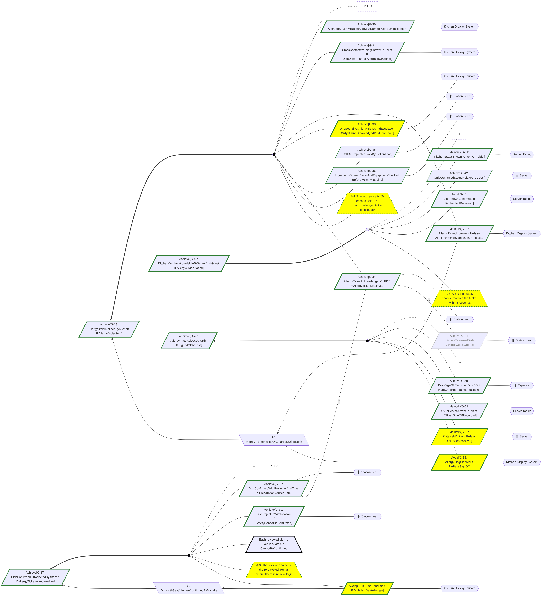
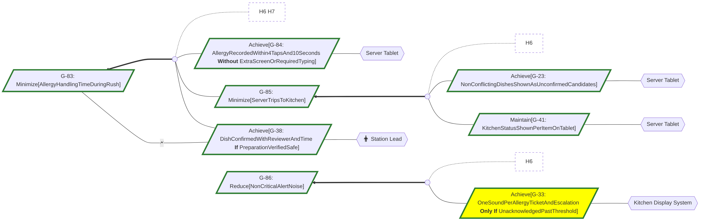

# Goal Model and Decisions

This file explains our team goal model. The model itself can be found at `docs/goal-model/goal_model_team.py`. 

## 1. The diagrams

The full model has 89 goals, so one picture of it is too small to read. So we drew it in smaller views. We only turned the views sideways (the parent is on the left and the children are on the right), so they fit on a page.

The sprint is shown in three views:

**Sprint view A: at the table.** Recording the allergy and checking dishes. [Open in Mermaid](https://mermaid.live/edit#pako:eNrFWdlu2zgU_RVC89ICditK8toFcN0lwTTjIG46D1EfGImKichUINJJjSD_PpeLbEmRHagTtwECxyR1eO52eKncO1EWU2eMnCTN7qIFySU6-xpywnkmiWQZfMbUG16EzlEvdH6Mx2Mh8-yaou6rLjJzoV3z4kXooNB5-RK9e_fuvZ70XTOJL16HziRaMHpLL750B2M0SVOaX63nsAmNv2Vzmt_SHL29fH-cvH19-R59WVEh51TN_gid12rjyyyNUbdb3da9v0_IOCHdG5qLjJvnHh426_BzETA4fhVnuMH5xCXNafxhvQX6QJMspxrsDLBmyTdymdJZHquFe43yakYZzJJV_iHYGMxBFXNUYFIu5jCUM7me8PhbTiI6hzEm2S0MTReZoPxzni3nMl9FcgWgX5mQe83s399bfppLOWyDg5ExwCMFfEIYl_ALyNjd-G4iJYkWJieIBPhP8FX76VjS5V6DhrsNGj3HvjaXR1WvYDzWIc1ZpAr2iPA4pfEpzQsX1bP6hHK1UJQe0vAVe6oKgJUCnPqNCoCt9XirALAoYWBWvJUCbD2Aa6WIvTGylCfCukJbXWKtDaF2Uo3Pcj1-zGUGY4RHtDRamH3Or3l2xxsjtuHs7g4Zxn-Ssd27VuLYL-0NmzJO8vVJFrOERTpYJQ6nOU2ABGw14-l6vxu8PW7wD0LFgvZroMF4441pSnIAo_G_TC504tYT-ZwLqO39lvWe0lLcf2YqFi5QcKqGUb6tM8QEItXs6JSTolNyFcpyZDMidMJwt4lGJbs9kBLYoJRhAEA4WhkMJAo5AA4LEziUMihkYqbgD5uvK9CHFMkFRUKSa7qAXcF5gCXuIENeTLuDlzsZHVij7AFZL8neRkbP6I0-tD-Q6Lp8_lnwzaoog5J94hh2n8odDx-CT-FE362i9rdnBY8LxxVPfs5ydW7U_fiRiSiF47AQKrtBVd177m5179kWrufuU_eedUTgVSl7EHegsJguaHRN4xk38lJiqWaPeZJNU0ry6jGktq4SDbBqRAeNRIOCAm5oRAPPutSrHcCeZwh-TsnVFVikiW2ZTTOepJB-QhV-4eqyK-u5U7Dw8W5F9Q9FxsIGtRiAUP-T8eJpxq8UGBXzBajCRJzzCGZYvqTxFMqSxZCtYr9t_h7bgmcmYYNaKwUPxLl81sxJQuX6I41YrNpeSLeklmNmta6TsssqxlWTzR-pZBuiI2gEmhLOtx2NP2pKOFs2fu1U8UAZ1BmoGE5ubvLsFiwGNb6ip0xViK5sXi8QmxCNUdnQ6O2JSv9QbAqtOliArMDWmw-4wZk236QRVINRmMfSOolVlSRwITJCpB7am97enmbI8w_HZ-PKZ9BQi6RP4cpsqessxqH21Ezjia4k2Op_7YjzXMOqCCzYs2TcGFy6a57CLYwJKPd619R88NVuHUbvg-ZrRxEv3Kj4uJB87PVrMtv3VdbT4ippKJyaeJxRsrk2Q_b_zSQEcscdYkPAg9JTDyMDheZrAVe2co_p9Z-ZTNGTD3VUbjMWKyy4IJ9zYgu5gNQxFjQ-5gqJRbQqfPix8mF_oKWv2e_-oNh80OR3v2hL62IzgIyZ6o2mRuvVu5eVOQFqyVymfsKEyp9Zfs5Vx6MkojkcW169fbeZ_u-ht-mEfz1EG4ig3ij0ve2bEJMxYrrK4dYgCxWHdPlepWOusuCI0PkLe8NgNHwTOr_nkveHLtDFa4mBiv7P8msYGLsIw9CZdb2G9y86aY451DCJZ4nqqrU2bgFHW8Ci8YVBi6ivjbpihVgtqShEUjVt2UraItZiXoUduVvYrXqNXIvbq4d8toK3ePM1jxTyaQodUwXPD0pww9FB2rL_Z3UIBw8R4iO0ArqSjdB071gsF2O_Y76O_3Jdt7TS3jzUh556U5rjmdWqCpLbUYu72Q2JIEXG7qsyXPWBmAh4BZ6T9Rj1UO_Rcx1Jf8ouSdkVH6c0kcoEBD9CrlNqHI0K1h4dxL7XqTDxbn6GfLvYb7N4YE1O4Md1O_ueDKpPjlCLxRi3Wu3_Mivcb2M9bmWE1yoMnt8G23dbrfZarQ5are7_svODVkYErYzotcsg78k86DwqTqjNahb22yXtsNXydubjFoW62zing5wldNSExfDPuXsH3sUt9b_pYpqQVSrVvB77Di8m1XEl9LIk4_IzWbJ0rdYe0fSWSjionYeHh_8AxJKVmA==)

**Sprint view B: in the kitchen and back.** The ticket, the review, the status on the tablet, and the pass. 
[Open in Mermaid](https://mermaid.live/edit#pako:eNq9WVtvm0oQ_isr-tJKcYsxGEwvUm49qXpxFCftQ-nDBhZ7T8jiw66TWFH--5ldFgLYIaZxEimKYs_OfDM7880M3BphGhHDR0acpNfhDGcCnXwLGGYsFVjQFP5GZOj-DowjGx31-4Hxx_d9LrL0gqDe2x7Kvw-03OvXgYEC480bEIppkpAIffz48VMu5eVSzuD3u8DYDWeUXJHf__QGpo92QTSbEjaBjzIqlqcZDgnfZdGEYPEDX5LoOMGUJcsxO6XhBRFfBLn8ExjvJJrzNIlQr1fH4li3t1-pCGeEoQPK5wleosmSw7G7u1LYGTwHJK3Taejs-2g_SznfT5nAofiFM0bZdDJLr1mhAn04__Ql_vDu_JPEPDvjhE_gTkj0OVuSbA9zMs7OBGGcJu3O25s477wcUG3JlZa-Q9QE_EpTVhHnZa73OEsvKSNMGThjCeFcGQEhLSejzCd0ykg0juNxdkL-JaEgUXs8hpvEw30hlNrMqBH2gY_GjEzSBYuOSVYzCFl3yEOcqIqURseQd0hfwBnD4QVLr6HYppCUmIvTWUb4DALRHhRvk6CMXhitZpJ-w5zduILdipIx-3owqWRkTVB79kiCDM3b2xj7Me7NScYB9SRnP_SN4KgSjmH_efFp7U06cqAicZKMF-KEzIF-SLQHUdxbapQSZLt71obuDZ4IQB9vMsrQR1_YFOiBQtFoppAkIen08L8FnV_C5_szAgGJZKD2SJxmJA9WGUjgoHYn7Q2ddF4CpbYxVDZ6kB6nM4IudLldYyo4GpqIkzBlEUfnShXCDC1q9YFETrdTAvJJuohIFhhBsDYG2qJX98oalZk5zuD4jxRUgl_LovRX8lKJTcBV7Ud9FnDlLHA8QEfe2lHA1Zfhto4Crh4FXLNxBZ6v-gl0nphm0GJ_UTE7IVeUXAPHsOiUXpIK4OOMzHGmoP2EHh1TEk1wTNZmSQFsONosS1zz2SFqA1bDwCg3ULSMXD_mafWqpA6x3FdXs0dKLK2eu_0NPbeeCZhWq7jlEIczlOVhi1AEahHlqBoi1TgypXRF3doaKP2085ob5DWnjWSIwcwmjQj5YZoQNKeqkmPo5ggjKO7FW3kiU1IshZM4gaKDkm63l9f4VUojiJI3auRHY1T6RjlwC1BoMV-235mzQY92h9sDUtCI26CRgdvQdj_TtFDJai9cyyneUO4XzlpC8bRz3rAklHse8XSYPLMxstkww2pUMssXXE2vMKjIwQyGWHyeELE28oU9F3hiQjKY_VEuXQm4Zz7ZrFbQKDHbklNVsiyjnGs5IWpCOE3_WRDeDttbKXLlQxW89VTb-rxdzTZ7kOeHcnhdyumwQPvRZBm1-zFoCb-9TQRaVz4M9GAG2C3bNFcRQLAWs6kkEuAskvOHUJjQNVAgZcgp-vhanpAuaSNuI-RmmS4acN4oKKeg_jTNAwBNRcX-gU4NW2j4QF31TdWs7bWFBV8GhVRbr-6bXiHXaIUOwIcBXu05sOWcQAwA0Mq4CwAF0WPT7hQKhQtJOzk3rE2CEtqo2awPb-YwnolaQgOu5wZY6Lca9e5AvY8v9EUVC3KeGkq91r8Kod3tvtl_OPsBxfPAKbTaTa1ADCpERySJdoU83th76zYf823wGEMBhK1iKZTV2qMzKOfizwme7idEjvuVrPiRVgL1mE-btGkAsC0kBaFAbTYY5X7aV2EC9oYJLddW3cLLRxN5DKtE6G02JXr6wYDXeDBg2yWnFTQrWbmxLylCU_RVsz0C9YHxqm959sh7Hxgvu3Zvy5UC6wPOvNhm8XzR0tnnDWU63NSe7vblMBcExrjXb1j7TjmXc6NO8INFBrvyyYLPVNcslY6se6XFnggfaqV6DJWhqc6uZcz2lmBG4AtSU-q49zr7xYjxQs_5nhwQc7gG_DY4ZBvo3Cq4kbXNReSpFx-wMAGfD0iMFG3n80_vmkZi5g928n_9V6YcH0pJPf3IP-qr95XvWKpHqJomc0cK99I5DuEtgW--raqrH4gwh4dKGV76MDI6K-d2BLkRPZzAJfkJiYV0AcEPF0vYVvP3FKiAbRE3Glg7NSj2_CZgFWmnk7TbSXqkYxTDj2nudDgKxNhFut1lqyHtdJL2uiBxzU7SVifp4V-H0-3khNfJCc_qEk7P7qS7U77BaBCmSZr5rzzPK8ODMa4KwQLQRScM0N3E7c0vyWqe_fsLhiGvUyp1Q7mzwk1ATbUiGW5Xn-dsQ5-xg4xLAgszjeDt9a0BS_mleo8dkRgvEiG_V5_9xBmVKxBXYjG80vyML2mylLKwRFwReByOjbu7u_8B-mysAQ==)

**Sprint view C: soft goals.** Speed in a rush and alert noise. [Open in Mermaid](https://mermaid.live/edit#pako:eNq9Vl1P2zAU_StW9sKkBkLz2WwgVbANtA1Q020PDQ8mviEWrt3ZbktW9b_P-ehoGTB1bESq0uYe33vuPcepF1YmCFgxsnIm5lmBpUaDTynHnAuNNRXmTmA_7I5S6yRAJ2FqXcZxrLQUN4DsXRu18XQF3NlJLZRar1-jg4ODwzbstuEgGO2lVj8rKMxg9MGOvBj1GQN5XQ4gE5IA-UZ1Qbk3xBPV52TfScxzThR6e3VYhcRUv927OkTvbrXESSYB-LkcwPcplUCG5YTy68vU2qtIXglGkG3fpxj4i0UCcgYSDfEVA71c3qGC4MWZrgpGVUFTyI_RZ8rpmP6AUcNzKOlEDcVHqrMCeL1os697agVhrdbDUgXhqmD4kFRB1IRdb7P_rhujM8GPBM8ZzbQhf0xVASopxJz31Rdues-pHAM5wpxQgjWoh4VYEXDdx3VwvX_MokkXOVW6z5hybT4mn7cfo3asiRngtEl0AfJUw_icN7yebiPsPd5G5Dy7bsr_yh8tN2dzfG4Uo2pgR6spVT4dwIzCHKTx8JCOobLvaV4790LCBMvaV19B0pwCSXAOT--vwMwjx3GO7QlIJThKGmeiT4DJ2mxC579z_DW70G1n567Nrt3NJ8YozBipyns8lebbYKqKdv3916D3xMYKvVU178F3oN-E_d69fg2ncw6JmHJiDNCyGtLsBrRp953KMGsGaJo-56xEbedfOM5uuJgzINdALrDSw0KCKowqjyjUEvSjxaL1SjXpCcMlSkplnLcmj997Ybp3YvmtWEGMBkCmGYyqLS-ppiZ339TTZ4Iq2PC54Z1ar_a7kdeL3qTWXc_ucy3wAh5NecawUseQo1qxxln2nBJdxG6n-Rm_chxnDZlTQ57Utzr0Zi3GRWvOjUxOpwLbYoIzqsvY2V1Pt7mAYGWOAhKXMfKR_9u6joZbbWNGr3nMINdVC8hcSpcM2hc4WtHuQkjcbmeDije5Tfkd2u-1feTmcpzOFkuN9Fugo63Q5hCwHTzaCh6628H9P8OtDrLGIMeYEnOmW1i6gHF9uiOQ4ynTVbx-9hVLWv3JqBqWC67f4zFlZYU9ATaDarNZy-XyJwg8e5k=)

The rest of the model is linked in the appendix.

About the colors in the graph:
- Thick green border means we build the goal in this sprint, or it is above a goal we build.
- Thin green border means a person does this step, so we do not build it.
- Dashed green border means we assume it is already true.
- Grey means we leave the goal for later.
- Yellow means no stakeholder said it. We added it ourselves, from a refinement pattern or to resolve a conflict.
- Yellow with a dashed border is an assumption from the spec (A-3 to A-6). We drew each one as a domain hypothesis next to the goal it affects. For example, A-4 ("the kitchen waits 60 seconds") sits next to G-33.

## 2. How we merged our three models

We had three models with 231 goals originally in total. After we merged the goals that say the same thing, we has 88 goals.

We gave every goal a new ID, from G-1 to G-88. We kept our old IDs next to each goal, so every goal still can be traced back to Assignment 2. The old IDs are in `goal_model_team.py`, next to each goal.

Our models also differed in other ways:
- Yuting put all the screen goals for one device into one goal, but Ethan and Steven kept them apart. We split them again when they become separate requirements. For example, G-30 (what the ticket says) and G-31 (the cross-contact warning) are separate, so each one can pass or fail on its own.
- We gave the pass sign-off to different people. Ethan gave it to the head chef, Steven to the expediter and then the head chef, and Yuting to the cook. Each leaf goal should have only one agent (heuristic H11). So the station lead acknowledges and reviews, and the expediter signs off. The head chef can act as the expediter, because Antoine says he makes the final check.
- We used different names for the same device. So we later align them with one set: Server Tablet, Kitchen Display System, Dish Record System, and Guest Menu App.

## 3. The sprint scope

We build one allergy order from the table to the kitchen and back. The prototype has two screens: the server tablet and the kitchen display.

We picked this part because it is core, user-facing, and uncertain. First, it is core. The project description says the system carries a guest's allergy from the table to the kitchen display, and that is exactly this flow. Also, all three of our models break the main goal, "never serve an allergen to an allergic guest" (G-2), into the same steps. Second, it is user-facing. Kayla uses the tablet and the line uses the kitchen display every shift. Third, it is uncertain. For example, we do not know if a "Not confirmed" label still helps Kayla (C-1), and we do not know if Sofia accepts a kitchen review after she orders (C-5), so this will help us know where to improve.

The sprint has 17 MUST goals, 5 SHOULD goals, and 1 assumption. V2 adds one more MUST goal, G-89, and moves G-25 from SHOULD to MUST (see Section 7). So V2 has 19 MUST goals and 4 SHOULD goals. Each goal maps to a requirement in `specs/001-allergy-order-round-trip/spec.md`:

| REQ | Priority | Goal | What the goal says | Agent |
|---|---|---|---|---|
| REQ-01 | MUST | G-9 ★ | AllergensSeverityAndTraceSensitivityChosenFromStructuredList | Server Tablet |
| REQ-02 | MUST | G-10 | AllergyAttachedToSeatAndEachOrderItem | Server Tablet |
| REQ-03 | MUST | G-12 | HandledAsAllergyOrder If SevereAllergy Or Intolerance Or SeverityUnknown | Server Tablet |
| REQ-04 | MUST | G-22 | DishFlagged Iff DishConflictsWithRecordedAllergy | Server Tablet |
| REQ-05 | MUST | G-23 | NonConflictingDishesShownAsUnconfirmedCandidates | Server Tablet |
| REQ-06 | MUST | G-30 | AllergenSeverityTracesAndSeatNamedPlainlyOnTicketItem | Kitchen Display System |
| REQ-07 | MUST | G-31 | CrossContactWarningShownOnTicket If DishUsesSharedFryerBaseOrUtensil | Kitchen Display System |
| REQ-08 | MUST | G-32 | AllergyTicketProminent Unless AllAllergyItemsSignedOffOrRejected | Kitchen Display System |
| REQ-09 | MUST | G-34 | AllergyTicketAcknowledgedOnKDS If AllergyTicketDisplayed | Station Lead |
| REQ-10 | MUST | G-38 (also G-70, G-89) | DishConfirmedWithReviewerAndTime If PreparationVerifiedSafe | Station Lead |
| REQ-11 | MUST | G-39 | DishRejectedWithReason If SafetyCannotBeConfirmed | Station Lead |
| REQ-12 | MUST | G-41 | KitchenStatusShownPerItemOnTablet | Server Tablet |
| REQ-13 | MUST | G-43 | DishShownConfirmed If KitchenNotReviewed | Server Tablet |
| REQ-14 | MUST | G-50 | PassSignOffRecordedOnKDS If PlateCheckedAgainstSeatTicket | Expediter |
| REQ-15 | MUST | G-51 | OkToServeShownOnTablet Iff PassSignOffRecorded | Server Tablet |
| REQ-16 | MUST | G-70 | CannotConfirmStatusShown If DishAllergenInfoMissingOrUnverified | Server Tablet |
| REQ-17 | MUST | G-84 | AllergyRecordedWithin4TapsAnd10Seconds Without ExtraScreenOrRequiredTyping | Server Tablet |
| REQ-18 | SHOULD | G-13 ★ | HandledAsOrdinaryModification If PreferenceOnly | Server Tablet |
| REQ-19 | SHOULD | G-17 | ChosenDishesRechecked If AllergyAddedAfterDishChosen | Server Tablet |
| REQ-20 | MUST | G-25 ★ | OnlyChefApprovedChangePickedAndSent If DishFlagged | Server Tablet |
| REQ-21 | SHOULD | G-33 ★ | OneSoundPerAllergyTicketAndEscalation Only If UnacknowledgedPastThreshold | Kitchen Display System |
| REQ-22 | SHOULD | G-53 ★ | AllergyFlagCleared If NoPassSignOff | Kitchen Display System |
| A-1 | Assumption | G-63 | OneAllergenRecordPerDishReadByServerAndKitchen | Dish Record System |

★ means no stakeholder said it (yellow in the diagram).

Assumptions A-3 to A-6 are also in the model, as domain hypotheses next to the goals they affect. The other assumptions in the spec only describe the mock data (A-2) and how the prototype works (A-7 to A-10). For example, A-10 says the tablet and the kitchen display run as two tabs of one browser. They do not change any goal, so they stay in the spec.

We changed one thing while we wrote the spec. Spec Kit found that the tablet said "Cannot confirm" for a dish with missing information (REQ-16), but the kitchen could still tap "Confirm" on it (REQ-10). So the two screens could say different things. We added a sentence to REQ-10, so the kitchen cannot confirm such a dish. So REQ-10 now traces to both G-38 and G-70.

## 4. Overlaps and dependencies

Some goals in our three models say the same thing in different words. So we merged them into one goal. For example, all three of us had a goal that ties the allergy to the guest's seat. Now it is one goal, G-10.

But we kept two pairs of goals apart on purpose. The first pair is "keep the ticket bright" (G-32) and "play only one sound" (G-33). They pull in opposite directions, because one makes the ticket stand out and the other keeps the kitchen quiet. So if we merged them, nobody would see this trade-off (C-3). The second pair is "show the kitchen status" (G-41) and "never show Confirmed too early" (G-43). We keep them apart because each one needs its own test.

Some goals also depend on each other, so they must happen in order:
1. First, the tablet ties the allergy to the seat (G-10). Only then can the kitchen ticket show the seat (G-30).
2. Next, someone in the kitchen acknowledges the ticket (G-34). Only after that can they confirm or reject the dish (G-38, G-39).
3. Then, the tablet shows the kitchen's answer (G-41). Finally, "OK to serve" appears only after the pass signs off (G-50, G-51).

## 5. Conflicts and our decisions

We kept every conflict in the model as a conflict link, even when we made a decision.

**C-1 Kayla's "safe" label vs. Sofia's kitchen review.** We do not show "safe" on the tablet. Instead, a dish with a conflict shows "Contains tree nuts", and every other dish shows "Not confirmed". This is because Kayla wants the screen to tell her which dishes are safe, so she does not need to walk to the kitchen for every question. But Sofia says a dish is not safe until someone in the kitchen reviews her order. Antoine also says the kitchen never promises "allergy-free". So if the tablet says "safe", Sofia may trust a dish that nobody checked. Kayla pays the cost, because she has to wait for the kitchen before she can promise anything. However, if every dish says "Not confirmed", Kayla may stop reading the label.

**C-2 Full allergy details vs. a fast tablet.** The server picks the allergen, the severity, and whether traces matter from buttons on one screen. A note is optional. This is because Sofia wants all of these details, but Kayla does not want extra screens or typing. So buttons give us the details without slowing her down. Our target is 4 taps or fewer and under 10 seconds (G-84).

**C-3 A bright ticket vs. no pointless alarms.** The ticket stays bright until every allergy item is signed off or marked "Cannot confirm" (changed in V2), but it plays only one sound. This is because Antoine wants the allergy ticket to stand out, but he also says constant beeping makes the cooks ignore it. The bright ticket is MUST (G-32), and the sound limit is SHOULD (G-33). Antoine only said "a short time", so we guess 60 seconds before the ticket gets louder.

**C-4 A named review vs. speed in a rush.** The cook confirms a dish with one tap, and the system saves the role name and the time. This is because Sofia wants to know who checked her dish and when, but Antoine and Kayla do not want extra steps in a rush. So one tap gives Sofia the record and costs the kitchen almost nothing.

**C-5 Review before ordering vs. after ordering. Unresolved.** In V1, the kitchen reviews the dish after the order is sent. This is because Sofia wants the kitchen to review the dish before she orders, but in Antoine's process the kitchen sees the order only after it is sent. We do not pick a side, so Sofia's goal (G-44) stays in the model for later. We need to ask both of them.

**C-6 "Acknowledged" vs. "confirmed".** We use two different statuses. "Acknowledged" means someone in the kitchen saw the ticket. "Confirmed" means someone checked the ingredients and the preparation. This is because Kayla and Antoine say "acknowledged", while Sofia says "confirmed", and we think they do not mean the same thing.

**C-7 Where an intolerance goes.** For now, we handle an intolerance and an unknown severity as an allergy order. This is because our own models disagreed. Ethan's model handles an intolerance as an allergy order, but Steven's handles it as a normal modification. Kayla says the kitchen treats them differently, but she never says how. So we pick the safer choice, and we need to ask Kayla and Antoine.

**C-8 A quick change vs. the chef's decision.** The tablet offers only the changes the chef already approved (G-25). In V2 this is MUST, and the kitchen sees the picked change (see Section 7). This is because Kayla wants a fast way to change a dish, but Antoine says the chef decides if a change is safe. So the chef decides ahead of time, and Kayla still gets a quick choice.

The last three conflicts are outside the sprint, but they stay in the model:
- **C-9:** Sofia would enter her allergy herself, but Antoine and Kayla expect the server to do it. Both stay as alternatives.
- **C-10:** Antoine wants the server to ask him in person during a rush, but Kayla wants fewer trips to the kitchen.
- **C-11:** Kayla wants notes kept if the tablet fails, but Sofia does not want her data stored without permission.

## 6. What we leave out

These goals stay in the model, but we do not build them in this sprint:
- **Changes after the order is sent.** This part is risky, and all three models have it. But a change needs an order to exist first, so it builds on top of this sprint.
- **Updating the dish records.** This keeps the records correct. But it happens in the back office, and Kayla and Sofia never see it while ordering. So mock records stand in for it (assumption A-1).
- **Questions to the kitchen before ordering.** This is tied to C-5, which is not solved yet.
- **The guest menu app, guest entry, and privacy.** This is a different user and a different screen.
- **Cooking at the station.** These are mostly things people do with their hands.It's more like a kitchen workflow regulation.
- **No connection or a broken tablet.** We would need real devices and a real network to test this.

## 7. What changed in V2

We found four problems when checking V1. All are requirements issues, our v1 spec missed a rule. 

**1. The kitchen could not see "Traces".** The server records whether traces matter, but the kitchen ticket did not show it. But the kitchen needs it most, because the kitchen decides how to handle cross-contact. So we changed REQ-06, and now the ticket shows the trace setting too. In the model, G-30 now says "AllergenSeverityTracesAndSeatNamedPlainlyOnTicketItem". This also looks back at C-2. We recorded traces for Sofia, but we never sent them to the kitchen.

**2. The kitchen could confirm a dish that contains the allergen.** For example, a walnut salad for a guest with a tree-nut allergy could be confirmed and reach "OK to serve". So we added a rule to REQ-10: the kitchen cannot confirm a dish that lists the seat's allergen. It can only tap "Cannot confirm". In the model, we added a new goal, G-89 (do not confirm a dish that lists the seat's allergen), and a new obstacle, O-7 (a dish with the seat's allergen is confirmed by mistake). G-89 is yellow, because no stakeholder said it.

This also changes one of our old decisions. In v1, we decided the server can send a dish that shows "Contains", because the kitchen review would catch it. But V1 showed that the kitchen review did not catch it. So now the system stops it at the kitchen.

There is a trade-off. Sometimes the chef could make the dish safe, for example "without walnuts" (G-25). But in V2 the kitchen still cannot confirm it. We made this change because we chose safety over the quick operation. We keep this as a new conflict, C-12 (G-89 vs. G-25). Problem 3 below makes it better, because now the server can pick a chef-approved change and the kitchen can see it.

**3. The server could not use a chef-approved change.** In V1, the server could not pick a chef-approved change, and the kitchen could not see one. So we changed REQ-20. Now the server picks one change, and the kitchen ticket shows it. We also moved REQ-20 to MUST, because it is now part of the main flow to the kitchen. In the model, G-25 now says "OnlyChefApprovedChangePickedAndSent If DishFlagged".

But we kept REQ-10 the same, so the kitchen still cannot confirm this dish. This is because the dish record only says the change is approved. It does not say the change removes the allergen, and no stakeholder told us that. So C-12 is still there. If we let the kitchen confirm it, we would need new dish data, and we would weaken the safety rule we just added in problem 2.

**4. The allergy ticket lost its place after "Acknowledge".** After the station lead tapped "Acknowledge", the ticket was no longer kept above normal tickets. But its allergy items were not done yet. Antoine said to keep it prominent until the expediter acts on it, and the expediter acts at sign-off. So we read it too narrowly at v1. Now REQ-08 says the ticket stays above normal tickets until every allergy item is signed off or marked "Cannot confirm". In the model, G-32 now says "AllergyTicketProminent Unless AllAllergyItemsSignedOffOrRejected". This also changes C-3.

## Appendix: the whole model

These five views together show all 89 goals:
- [Top-level goals](https://mermaid.live/edit#pako:eNq1V11v2koQ_Ssr96WVoLGNv_BtIhFoEqQ0qQLqfcB52NjjsKrZ5e6uabhR_vvd9QcxNNziJkVCyJ45Z87Mzs4uj0bMEjBCZKQZ-xHPMZfo5jKimFImsSRM_SZgBc4sMi4sOzJuwzAUkrPvgLofu6iyRrXb-_eRgSLjwwd0fHx8Upnd2tybHUXGYMVIMjvv2iEaZBnwe6AT4CtIpqx8JvF5DkLeRsbRLep2G0F2VdlalYMugj267Dqw_aKuXmV2bK3rCyZUqq-S5jW03UDMeCKGOedA5WC55ExpHdDkG3CSEkh2ddpvx1rLt4q6xXMCK1BEvZpnPcEpfM2whLKC6NPdyTj9dHR3UjuMiIgzJiA5hZRxuOYJ8ImKuE_0nwpV0VtBswNcJ0QTiTOoGKYk_g7yjGWqFffXtTVHhbOd7dTc_ia3QusFpkkGyTX9ipfAG_mNYEViEDo_1XgQy_3a3jxGRH9_71RIv6-R511VqDGNOWChlGmnKc-FHNNKXyGN0Ptfbzs_-L9h4Ad13OClTef3K7Nrb5fKt7U-1TkLVR9dK6VlBDERKmyjUIXyCywmCsXrRd_RvJHw5jEqXs_Z2dq-v1lnzT9kNCWJ6n2Cs33aWnNsWuF3FrSG-iXUbUDV7knTbehkLSQsDugET3eCt6cRvDqo92Ij-LW5V2oK1Kz5QihZkH9htpPDlCxglOvlusnFfLek3uuYarRbob0Q3UCSxzC7YnTIiSQxzgaKRV4xImBv9Db4GmNVGL-huKz-kFXbWJX2jmXJSxEPQNeu5k63BUGIpvguA3mKpQS-vsRCis8roKo0kzlJfxXc6z8-FrOHVzxPTw0v85Vxn5u9dcfWx-9uZN_66fgdrDDJtJgzxsdULNXcVa39cuKbS05PJa7m9ByVJKgM3czeMd9Gw_Pwr1pLoceL4qowOyV6v93AMi_3o0I3Dmq5Na6CQGt7QNVM3LydRVFkXOsz_opd5VKMtSayhKkqszqABkJTjUAsiTr11dUQks__5GS5UEMpMqLoWV_fbARw7M3bKoC7m_R1Lq_TyZrGfxM5Ly4VO3xWg29zTetbFZ-3GZTDOab3cKmavdzTw_LwVPVQ78Q2qe00SPvWnzuxXyk2onGGhRhBiooOLOdq9wdJ5DzsdcrH8J1pmg3PlKgYSfFTmP5q2CirRvMWk9nRzl22xDGR69D82KTbBiRYqNXneB0iF7k_4ToSHmQXZ-SehhmkUqeA1EfIdQaourOhmGWMh--CINikgDGOaMNLrdABXo55kJeNapMNftKzO1vZO8uHLXe3nbt3kFL_IKW-dZBXr5VA323n7rdz77dyD6x27r2qj1P1Mc1OK6zbEmt0kLEAvsAkUf-CHw05h0XxfziBFOeZ1Pbi3TfMiR7TonBLGZVneEGytfa9gGwF-pg3np6e_gN9izdp)
- [Recording the allergy and checking dishes](https://mermaid.live/edit#pako:eNrFWltT2zgU_ise9wVmktbXXNzLTBrKwmxpWALdB9wHYctEgyNlLQWaZfjveyTLiW0SQ7qEMsMAlvyd79yPFO7NiMXYDAwzSdldNEGZMM6-hhRRygQShMHPGDu9y9A88kPzRxAEXGTsBhvtt20jXwv1nr290DRCc3_f-Pjx4ye16Fr5on35LjQH0YTgW3z5R7sbGIM0xdn1YgxCcHzOxji7xZnx4erTcfLh3dUn44855mKM5eqP0HwnBV-xNDba7apY6_4-QUGC2jOccUbz9x4elvvslyKQ47hVnN4S5wsVOMPx58UK6DNOWIYV2BlgjZJzdJXiURbLjY1KOTWlcsySVu4u2OSY3Spmv8DElI_hUUbEYkDj8wxFeAzPiCC38Gg4YRzTw4xNxyKbR2IOoF8JF41qdu7vNT_Fpey27s7I5MB9CXyCCBXwDci2tbTdQAgUTfKYQALgv8Cfyk7HAk8bFeptVqj_EnJ1LPerVrHtQLk0I5FM2CNE4xTHpzgrTFSP6hNM5UZeeknBV_SpVgBbVoBTd20FsLX29qoCwKaEgFrxqhTY2gJ2LRVtJzA05QHXplBal1grRbBelM9HmXp-TAWDZ4hGuPS0UPuC3lB2R9d6bMnZ2uwy2_6djLXsWorbbkk2CCUUZYsTFpOERMpZJQ6nGU6ABIga0XTRbAanwQzuTqho0E4N1AuW1himKAMwHP9NxEQFbj2QLyiH3G7WzH-qltqdF6ai4TwJJ3PYyFZ5ZhBuoGp0tMpB0SqZymCZoSMiNMNws4p5lWz7UEpAQCnCAABRY55jGLwoB8BhkjvOSAkkMsqX4Bcdr3OoD6khJtjgAt3gCUgF4wEWv4MI2Ru2u_sbGe24RukGWU9Jf1lGz_BMNe3PKLop9z8NvtwVMUjZJ9qw9VTsOPYu-GhMv4a5au8n7LYhFIfg3GvMZRdpVs_bnPSO_8IkNFy33v-gpUPqgLM16jcmsDQGsJKcSrAH-JZE-BCRlDer1TBWON2X5yFDvjYu9-W43F0_Lus26PQbxuW60TuPBztl5BHNNaxUWjadyXBT455qSzAZbQgEzcV7Yob2d8rq9cbO_k5mv_6rTWX9Vyl-_aKGu1ZVzsrfYJhCiwLrkGXSZHWlDgiPUvBRMSdpj1fzxbc2D5d-kRJW03Dp6zrsOVXKDjgBKEyGExzd4HhNZMrVY5qwYYpRVrW3FF0l6tmbE9srKNhrEttztEmdWuw5Tk7wMEXX16CRIrZiNmQ0SSEWuKyzhanLpqx7r2Dh2puLoLsrMhrWq_kA5sRvjBZvE3otwaA1TGAoGfALGsEKyaY4HkKOkBjilzfr5jbo5r0wCe3UWio4MBuWR90xSrBYHOCIxLIMQrgltRjLd6s8KZusolw12FzVRXrGEZxD1gWcq8uBu66TeDpt3NpQ60CtkCO4ZDiYzTLZw_NWfUpkhqjMpvUE0QGx1itLGn6DVzq7YqNxe7VK5cnaKwP0DJo1ly4ZzMWEZeRfKaDinPF8NksJzmA_mUFr-vLPnMymIFVPMM1Kd2ut8wij2JASytr3XollUbh3Fq26_9QPgnCbljfiPKeAY15uH3eeQSxLRgLTQl6V5UuNue40HEwdd3d8lqZ8gYaikWred6Cd_kkEUKMDda4aXckynLMsXdbJ0YlwKFj1MbsQBLXrWb2ru_kO19NjsdddV0p0-Hr1kgpm_ktykhEFkXjOZCB9Jyg3CeSunJmOcKo0upBHSsW7ovSGSl_waaj0nrdzWlpAvWj1ApXhAw4BcExP88Tf6Be5AkLV0t7ZnE_q9z7FPcB-symevMfwOr-D7zJRXiO8tSg1aVfyrMSx9t7aewqZHXqsrM3SjpXnd1EioTJMt2G9-Thv2yA-NN_YTs_r996H5uvcr_2mu0tt3Q0q7_Dji50dUos77q6Mop_lO314dhmGoTlqO2sOkkrMMeUCJoNRIs9IKiRXgP0VYHGMgYcaUd1BShsMOJ9PMS9iU47gbC50hqluVIF1vRUqoO1kKP5_LEPIT8T5AcweKjfzltS-I7GYBG4r_zN4Y1lWaac-98kfaul9aY0y3dUqSFZLbm6zGYogSAPrbRmu-kKMOHz-maFFYPiG_-i9lsA_RRul5JoGKU6EVMGALy4WcD-kDGIUrB3cjV2nVWHizH6GdLXZ3Wazb0QsZVnwptfrLU2DECrv6WqzJPBlWa0mdK-K3je22GzbW-12f5mV3dnGQvZWSjhbucpxt8L2qyo_7Tmn-wz3utY2JFxnq93eVrs7v-xTt_cMTb2tNPW20tTznkOg85xNz1HF3y5ZtkhhCNHWo7oFZSukZsswpzC2IBLD_3Xcm_AxzlT9h0eMEzRPhVxXz77DZ1qyOXG1LWFUHKIpSRdyL8zHt1jAoGE-PDz8B1YltJI=)
- [Kitchen, review, status and the pass](https://mermaid.live/edit#pako:eNq9Wm1v2zgM_iuC9-UGNJvj-DW3DejLdh1utxRNd_dh3gfVlhNdXTlnKeuCov_9KFl2bdf14jVpgaGYQ5MPKfIhqfTWiLKYGFNkJGl2Ey1xLtD5p5BhxjKBBc3gd0xc72tonNrodDwOjW_T6ZSLPLsiaPRqhIrPQy3322-hgULj5UsQSmiakhi9ffv2XSHlF1LO5Ovr0DiMlpR8J1__GE3MKToE0XxB2Bwe5VRsLnIcEX7I4jnB4jO-JvFZiilLNzN2QaMrIj4Kcv0tNF5LNJdZGqPRqInFsW5v_6QiWhKGTihfpXiD5hsOr93dVcLOZB-QtE6npXM8Rcd5xvlxxgSOxD84Z5Qt5svshpUq0JvLdx-TN68v30nMyy-c8DmcCYk_5BuSH2FOZvkXQRinab_z9jbOO88HVFvypKW_IGoC_klTVhnnTaH3LM-uKSNMGfjCUsK5MgJCWk5Gmc_pgpF4liSz_Jz8SyJB4v54uNvEw3smlNpM0Ar7ZIpmjMyzNYvPSN4wCFn3nkc4VRUpjc4g75A-gC8MR1csu4FiW0BSYi4uljnhSwhEf1D8bYISPDNazSTjljm7dQSHNSUz9ufJvJaRDUHt2U8SxDVvbxM8TfBoRXIOqOcF-6FPBMe1cLjj_eLT2tt05EBF4jSdrcU5WQH9kPgIoni00SglyH73rC3dmzwRgH69zSjuFH1kC6AHCkWjmUKShKTT9_-t6eoanh8vCQQkloE6IkmWkyJYVSCBg_qdtLd00nkOlNqGq2yMID0ulgRd6XK7wVRw5JqIkyhjMUeXShXCDK0b9YFEQbcLAvJpto5JHhph2BkDbdFvemUFVWbOcnj9cwYqwa9NWfoP8lKJzcFV7UdzFvDkLHA2Qad-5yjg6cPwekcBT48Cntk6An-q-gl0noTm0GL_oWJ5Tr5TcgMcw-ILek1qgM9yssK5gvY39OiEkniOE9KZJSUwN9guSzxz7xC1AatlICgMlC2j0I95Vj8qqUNsjtXRHJEKS6_n3nhLz609AdNqFbe8x9ES5UXYYhSDWkQ5qodINY5cKX2grrMGKj_touYmRc1pIzliMLNJI0I-zFKCVlRVcgLdHGEExb1-Jd_IlRTL4E2cQtFBSffbK2r8e0ZjiJIftPKjNSp9ohy4BSi0nC_7z8zZokd77u6AlDTitWhk4rW03c80PVTysBd2corvyv3C6SQUXzvnuxWh3POIr8Pkm62RzYYZVqOSWb7manqFQUUOZjDE4suUiM7Il_Y84Ik5yWH2R4V0LeC--WSzWkGrxGxLTlXppopyoeWcqAnhIvtjTXg_bP9BkSsf6uCtp9rW79v1bLMnRX4oh7tSTocF2o8my7jfj0lP-O1dItC6imFgBDPAYdWmuYoAgrWYLSSRAGeRgj-EwoRugAIpQ07Zxzt5QrqkjXitkJtVumjARaOgnIL6i6wIADQVFftHOjVsodEjdRWoXu111lWgSyfobdSBbtSByvRTulieU36l7BZwNOvLHZloVDXiBgdotub1bVK-3xmmClA7L-FIjlOC2QkMZpEcPatZDLoPzGr1M24g7Eywyky7UE5BGYLpLqllWmDtBZNWareUSop9oA9W6xgyAE4Zns6LYYKkm5r-hulNv9OT7UaAwN47RG3AbRnwHzFw33fKZao2fauyLwfWR33fppUG7t5wlSQQ-A3WcpqXLSfrHDYIXUlyeOws7LGpKtvurGz4MCyl-mp7bPqlXGvGdYCXYDNXFxhwfXEO5Aa5-2CPVQeu96HDBXRALuQ8UTT9zrOooAXtKfz9jxWEVzQ6FeDaN8BSv9Vq5A408tmVZuDy5qvg_BrtdUDod3tsjh9va4BiP3BKrXZbK3R8FaJTksaHQr7eutBq2vyZb5OfjR4AYadYSmWNudeZVAvvhxQvJE3nDT7-nNUC9TOftiENALArJCVJQG22COh-jVdhgrEMVq9CW_16rbpzLGLYuFIDwKHxYmz5duD_HhrPvunu79JMB8135Zn8aHzbMJbLRRgas9G4Ze0vyrncY_S5FMx7vuZLNZ5USgPrXml5bwEPtVK9FsnQ1HepKmZHGzAj8BVpKHW8e53jcuR9pnvnJwfEdDvA7yL1d4HOq4Mrx7fdLMZPPfiQRSn4fEISpNimaNujGxqL5XRyUPx3-sKUXa-S1E1b_lIf_V77jGW68zc0mQdSeJStcATfWk3NV3V1zRdizOGSM8ebKawwzoP3DgT5IUY4hUOapiQR0gUEP1xs4Pak-N4MlbAt4sUT66ABxV79CFlN2hkk7Q2SDnSMEvgxzYMBrwIxDpHud9lqSTuDpP0hSDxzkLQ1SNr95XB6g5zwBznhW0PC6duDdA_KN-gKjQBFWZrl0xe-71exwhg33rDRFkLuNkL-FkIwMw_xB2bOYeL29glitd_99eSCuWhQGg9DefCAF4EWGwXq7laf7-xCn3GAjGsCl0c0hr_kuDXggupa_U1HTBK8ToX8XD37G-dUbg1ciSWwcX7A1zTdSFmYu78T-GoIG3d3d_8Dk4q3zA==)
- [Dish records, changes after send, and no connection](https://mermaid.live/edit#pako:eNq9WG1v2zYQ_iuE9qUF4lai_BatLeCl7VKshbO4aT9E_cBIp5gITWoU7cQz8t931IsrKamtrYsDGIbD491zb8-dtHEiFYMTECcR6jaaM23I-cdQMimVYYYr_I7B63uXoXPaD51vQRBkRqsbIL0XPVIehpXUs2ehQ0Ln-XPy-vXrN-UxLY_p8PJl6HxiXBr8XP7eG_oBmUqYCAH6GuQ5RErHZ6Df8mx-Diz-bT0DvQI9kfEf3ERzkN9C56WFcKVETHq9NgA62GzsZVKoIrN1ZmBxf_9dlA7_ZzCFOn9stU2iOYcVWGX9oMRwDiueAd6eLM1caf43xCdzSMirqzcfklcvr96Q2TJNBQeN8jyFqX7315KnC5DmZM7kNWS7ffZHm03CgoT1UtCZkuQUsRJroua2Pz4QzCq4bTuDyk4hfKZVyq6ZgfjPJQcj1tbOhRSQZbmtSWT4qkzFeqpjjHqSQITy-wpgtLcAxofBWFrx3ZaVYUBmKYaQifwOuxJgFU8lGigjXZXgB5moSZpqtcLEQKI02ArkEewLwvFmU9Qq-Wz1m7r_vvvkyCoDtN1ho4C8i7lRtoc-ssx8Ac0TDvFnvoAi9HsT7Hv7EuzTn7dfaejnIVopHtvr44BcSLbtjyZTWMX7sPt7sfd_xnJ1d9y4e5zfLZNVT-AF9vsHWU9cE3NrBPgjOwLGj48Af1QZHz02Air-8fxhs-hGbkBOckMnSiZcL2ZocZnN5upW1rjHRq0O_RPPMi6vp_pCrsocPh7777gGu3pieBh4h-cE6_9Pl8VWRf9BR9GANIsxO1lqjUOhwoid9qUZglZZebvKyqvS5z1aVl5VVl4rogPk8qnAvo5uwJxDKliUQymY_ZRfzwV-kKprScxDXwjEk8SAnoH8QVVtYbnItOUyYIsA7awf6WrPPQjMykg7SYNhlaT1Ry5vzjRkthEeKP2k4jxPXZ33vB0t5dGngVNp7bciidReBqXY1wSwrNBZ76JCBLe56EaqWwHxNez10m_tV-_uUkDGBd1wt_9EwCq1LWIa4ETAyKVM5500MypN89I5E7ixnMOCxVALaL1e7DWkMW32uz7osFoitKfHuGUgr0FiA1xfUUxUW1jRSO-VwEeZH_EN9Xc8yVC_WqH8Ld-gWMJRf1wjHlqlm7apHAfGNEkEl_CVaYlDoFw1Kpa8SGN0_sEAAUu2GVZIhDB3LLpbgF4n5qHuYXBWVmjLihcQZP8rJmzWGVZRmSjcrY2KlLjImn3fQJQb3xMG6nUpUUqfGOC2Pmm7_Y-3ZJeT2imTMZbSVObGukf22LXe3LUeqI_dyzAMnWlv0B7D06WZJrO1jL5yM8_7LXTCsIZzXNN37B70keg_oQ5lJFiWvcVH0rwUis7t3fLYzAP_qPgZ_OK6bk2y7Fv7lR_9WjuTqmz-hib3yAr30M2Im3Xgvqira16IWYZvSzRbB2RABg_uHRm4Mz2GA1wGAhJjXSD4l5k1bnfFwzjBClM6-GU8Hm89YIyF8rsQ7gydpGgnqX4nqWEnqU7oaSf0tBN62gk9HZLqiMIo9ulRI8E0vTt6kEDMX1NHJ9_8Tr75nXzzO_nm7_atn941xcf_SrxP94s7R8RZgF4wHuM7w41j5rDI3x7GkLClMPY8_98XprldCrNcLFHSvGcLLtZW9hTECgyPmHN_f_8Pj8YBlQ==)
- [Guest, privacy and soft goals](https://mermaid.live/edit#pako:eNrFWVlz2kgQ_isq5SWpMonQjXJUETuJXYmPBZx9sPIwlhozZTFiNQM26_J_3x5pJAsFc-yC1y8kqNX99fV1z_CgR2kMeqDpwyS9i0YkE1rvR8gIY6kggqb4GUPbaV-F-kVbO7ZD_VcQBFxk6S1orbctTT0PS8HXr0NdC_U3b7SPHz9-Uo_N4rFlXL0L9W40ojCDq28tN9C6SQLZzbzL4j5-l1Ex70GUZjHEX9OsD0RoH64_nQw_vLv-pH2bAhdHlEdJyoGrN3-F-rtfWqvVQLI3U8pR217U71mlAWBfaSIgg_gU2LQ7IzQh1wl8hmGawU_Kqcj1YBSv0yT-HXnbth4ecvuaVKB1J5PHxycx294VglKP29BjB9phlnJ-mDJBIiHjNb3mgoqprAdeRiW-gAz_PRqkOdh1TjkrnXL3AKZQ6XuLGm0j0L5TEY2Aoc4hzcZ5mcuwYIwGaR8yLA60U6B9KglVBOdYMNlFQiKInym9fVtUVjoNK3ZlpQczCncQy4BIdUXin-o6V8hXJ8z3Hx6GJBiS1gRlU6b1CzrQfgCJa6nzO7uEU1aBnyubpTSWNeAE2iWTHTukEPeAcD7NCIvgPKvqPQM4TAgdL0lJg8psD6ns2F_OY7ZXIvAqHkOxIUU7cY3QbF-xTKMHTezBszRPc0IjQdmNdBp4f5TesS6_ZFFRABAfEhbTmAh4Jg8lEgvJoCgQbSCbWNRib9k7RqFSadejb6My-Xr-8mH5Yq1KVZbPUlEmerVH_gqPfHuXEJQus1GZZqCds2ReKZKVPeU9SMgc4pVsVrnQbjZH7k_dEfO_Gg_ZbpqhHMyNeejhQMwb7wgiJKKUnZIYPs-bFNSj_BaZSQW4APudYRrW0X2nEaFccZ3yHWOfyKroOY0EeJiAE4YEhLHPrcjuUIaa8_-Y8HxTgMX53yAU15KEYi0nFNcKS6lli5FbDnOnOcx9nHs434CJ82tBKCvqvUadCtNFliI7QZ_Mnuu7CoKzovEQwM6RlAqbI70TaLnQEREEM9gDgboxmtUsb-hX1r_RGbB1Lq7cMhx3b5BKxXmvnmKUZKRQs2-oYlZBkga-w0RIDsCt83CaZTKwUkKauGQJcL61197DQz5ci31W68-5gPGC5_4LACwrvdHPfjvQVG2U7HyOvY31t8Dhedp68Jf84Osc7qxz2DV2jabUZ9bZ2DerY4UklT6enyD-DPOU4ZkijS8ymJAsp4o1HrnttR6Zu0BQ8aJrNwrB8xYU5QMqll1AkuW855mS91zt2FtOfV4J2DOXUZ9Xud5oRt-ugJTnsz-pGFFmD8iEY3e2jT5-z2Iu8yUfpVORJ-3LvchIP8Lxx84zmTyKsRjMJ0jxy8NfQXSdFdToui-OtDSYdysawqF_Shkd07_hqsA5yOiED1I1_hprr_SrOaXytdd9ZkqVa6_rLZ1Se992SwC-0ahKu10dI4oRn-vGw94Jtsc5K5K1WqfXWbFvGv_Z7lNHbZUsha3BTpZfbLrVeiiLRvGUPCEO6BhqLFXr7p9qI-yTIawudrez2cnOM_aOsYqdZ6nYWbXYqdY6xtpJsLak3qOp3Nd6Uz56hpPsFVXulSuOZy8lJKd47DROspYlV3bop1MmbxkUqgGNbkFeR3zhEUmKAKLTcmxqyvNLRqJb3Ejx6HiDFxSEi8EoAz7CrDyTIQXQwbO3qhUZ6QmeDX4fCE7nheGq4Jl-42INy71gv8MRYTeAw3VCbrDV4z-mFATqX1wbukgUM6hfbXSHQ4gErAlK21y75Zj-y2B8KltHla0r9cfTCK4kH-LVIsUod_F1cZZSDrX4WTbiDfVXiNHu-O9DfZ9H3x1eDJS3qs-g__-G5B4vekv-e87naoX51_T1Uvzq-7JL7hdv4_HbqzAM9fNWXhZnU8FP8LIuohMYZCC7o8ulqiPgEyqgWC2_YBomY9wLQz0McwMhixK8hTiCoZZ3bkG7rTsai1FgHRT_DV4ZhlGTVDdq8iN_9L72jKWKuRc0GQdSuIWNG2FCA-NtXd3iCzHhiDUj80BzNOe39w4E3IsWSegNCxIYCumChn9czBPQVJmXsE3wYss8WIBiT-5DVpO2t5F2OsrrIf4ZxsEWr3pbwfK3kzZXSpsN6a1c9r2tpDtalCZpFrzyfb8KDyGkLoTNuImUbW8k5W4k5W_jBV5rbRNQbMrttG_kmLORY46_WJEbvOIamyh2zY2kNnLFdbeKj7tdsjxrO3Fnvbh-oOljwN96aIw_rz7oYgTj_IfWGIZkmgj5PP_uJ8moPE7wXGyIv3N9JWOazKXsMSQzkMuE_vj4-A_AJSyR)

You can also open [the full model as one diagram](https://mermaid.live/edit#pako:eNrFXVlz3DYS_iusyUtSZSW8j9lNqmTZjlWxLa2O5MHKAz2DkbiiyAnJkT3r8n_fbhwkiCE5pESOU5WKLYGNr4HuRl9Avs4W6ZLM5tpsFaefF3dhVmgvr26SMEnSIiyiFP67JIZvf7yZvTXMm9nf8_k8L7L0nmhHPx9p_Lc3YtiPP97MtJvZTz9pv_7662_81474tfXxl5vZ8WMaLT_-fmTOteM4JtktSS5J9kiWVyn7e7T4fUPy4u-b2S9_a0dH0iQqKhNR2dpbvwWXKSY2G3FZ_Ne2ibjeh1FSwL8AzZWwXZBFmi3zk02WkaQ4Xq-zFLAeJ8s_SRatIrJUcZo7OG2D4mwGaRsChdEE0hY8mK4K0pprZwmp4zwn2asov7sg4fLlli5rBlD_iIrFHUkoUoDwKY2XFeASgOl8_Yofa4yUdrnNC_Lw7Vs11HRHBsPIWT6Vi8VdRB4JErPnHMMFeYxyAl8fb4q7NIv-R5Ynd2Sl_fvTb6erf__y6TftcrNexxHJYHy0JmfZ63820foBdurkLkxuSd7Ns-V9_boK56vwaE2yPE20t4BVwykkti3_QDDF4qrzOGIeNvg8S9fhbViQ5X82ESniLc5zncQkz-lcx4sieuRbsT3LlrDqqxVZFFxUOwTA2ysA_mEw8lksXZnFnWuXa1jCMKbfhJ9igoTPEpiAr7QQwdNklQptfUlWaUZQAqMF2bcIwdevTFa1K6RfyPxb-uTIxAQ7Nsmba6-XUZGiDr0L80LYn6vogbCl37vBlrFvgy3z-fMLCrZs7V1_rl0nYakfdUuBhPdht_Zit58zs_jWr30b0G-F0Zc28Br0_TSRN66OWTkCLA-PgJZzyvLE5F7TESDsj2G5daHz9Ll2Qic6SZNVlD1cwoyb_PIu_ZxItgdXTYb-PsrzKLk9y66TR_kM21n7CpfTpRPuYeAd3iYg_88Wi5LECF6GcGeM-hJYgs72MlyR8xjMLvOopFXmA2CxF3GaC_bpil3CjPudGF8HCT43WjwtYRd9vZRgGLaKYNal7HKJc1fdxJIDYPmS4L4XW2FU3qQAMSwkZqh_KFjJ-ZcqC7rKApxZoINOIwfiYDP9Bg0srb4i39WyF3jSXaVcRxSgCL5FxcS0uuKG0O9kJRsLAF_-Oh2_pPM6KUhGSm8NCTFBocQugNbZiloAKjh7mDIVphhN2bGaAg2j6dVpBpWm5UK8QNKusnABqpLkEXgj8KOTO5Cn5E2WgqnKNotiA0TfRXnRyabbbhu9ycAwwoFiUQy90qOiCMHNpjIRFkD-NfyVrtMpHJudDPntDAVjzMtlOaivimHM6ZZm0QIV9m2YLMF2nKN5YkukSvV7MFswMJc-qpsA5Ec1YmjDrBYbJkxYpwXjK2AoqmiALeeQj3PZrZVjAGRE-Lz0iMroz0-TIoWfhcmCSD8VbF8n9wkcmM0nlMCsd5zPxvdELI5PZW5LmhsmjZIw275Pl3DSLehmSRjOM7ICEDAVnujdy2B2uSmTQOFEFc_HgMhQrMZJHLIT_K-ouKOCqwrydZKDbndz5uyzpYY7MhThtSA51GEtq_RMi3ItrEvHC1koXkhLpaWZxiXiZnZz084is5JHEEgewwSShAGBMNE2jIaWC3MAGO7YxmlxBIocsl_BH7i8bsA-xFpxR7S8CO_JHcwKiwe08s8gIT-eHHk_tSKa2EbxA1JVSac0oxdkTQ_tl-HiXj7_6t5cZ9hXHsP6PtkxjSnwcJqOQrM63t-ji9sqijwxgqdIN3t2u9KbzsggODlPPf9oPJCj586ofkgLGhM_VvGIiHYIRgZvwijOu9nqcCtMb3wcKPKKuxygu-w1u8v8GDSDDndZXXR317Gji3yWMA5rljZ9WBfNUcrOinEs9h4f2pkU1eHczmAS3y84mFcWHMT4BcKGTxZqcnFS2DBhGzCjgZF4sX1FQKQeooSF4lLwgqIUYZpDNTtNzHUFtY7e7tI6QhE7g3KHW3-Wn5A4MRgnkMle3JNlgz7gbzHpcRKTMKsjdXaAsiJIszkRSb7GEoiogOxkJE2TAXwTh7e3ItlRIcOkUwwSmKN1F-spb6AqM2VRwGg3vdZUYDhZW9kD8E4_pIn4GuQFiRGWQzvOr5MFy6xBvQE0M1qC1uTdvFkdvNkjg-CbqiigCR6p7GALTVlESzS-SuEEp2KjqXY25np2860WPbt87a3RnLCyuBGyms4vm6uNms80HaxxxRShyNDxakeEGkLtSaIqCBeIxl0pYXTkV0V6dXw036n4ZpWmeTLJ4CeMGupBvowdtUx-ATUzbbvm93iJ6rkqWAGTfdSpV2ZH6Gla0-Epl3IE480pKfJgwoHJS7bHNHI6-4Qmr_-JJiYCO9HrnPDas7Q2d3ztpjqJzT1nWzVfsMz_QUwoUSCbVykK0p9RyJYE9AS9orckXrIaJQSNFHeN6RarKvB0WFXbnhwWn0A1EP6cVrKP83usSZwzr7h1X_A3MCn91Y8XGyi0KZkdEen_1L0UezMVtvs98JaKcgjx5lNRX7qmZxJG5bvGTARqx-HcTJ7OVheoDGJYehBCSggcwRzzVdsl2lpU2tF11-MNPC3HtMuFyvW6HFiXK76j2FdLlzuMmKNPQ6-cno1h8SEEnwXKZREco2Ah8dgsWiMkgcUBSy9Yhx1Yx-F2txbtWFNA4jSVCNYCU3-SpXkODhrEfcVfYZbAjlPvTJBQ5BWqlOC9hRBmvsm2JHsZ5nB4XxcYkcbdzNt9mHcOB5TPpCZCrLK0umV0qSIk3B-S-1DimI_DVc4vo1tQorPV6gx8mv-298yU6-H2WQ_vQCj5NEoIb7HWrMt0k2DgXpsQcwP5IozLTLdcNYcK9wJzrqBs4DKeQ8vH1R0kgTGP2r0ofp9FCQ6MllsStXRuK1twLBE5S_54dblr39hAztkeAXF3kq_M-mnvoNFMWg7XmBYfp66aIwc7NOL4bFMoOReGEkF2s2f2ZM96JgD-uWpR4PA-TW7BPESgNNxSoJFAcyoFI6VXLR2N1UKCDepm0u7JpHMIlHwO5jwdgXhcQYHjnqvb5zAqcs3VoRQCQfky1z5RUqx-IuuHVjBze0tgfJxu4MRu9EDcsgVmbL-AJ0wVqpY3L_MlNKVQmbgOyruqsdf18DyaN2vrHfZE6b7T8_C45-EpgazlK1ywrM9jRD7TFlhsmavXFddhRqGJdh_06xqFUgBzg35C6emTQ-QTKBGoFbAJxPYx-mHdp2fuK2sSe0lKLJ2ce0ZPzs2JgHGyllQZpcu21JbYnwh1SXmJJJd_h1yjypV8soARu7tQxfkkmZaAi4iTYGEzgyKptqb5Hm0FzgMUQcGWbH7GLzI6KknhyzAGHQcL0j2fK7e4-YEiH4pnhvUJWhcT7mz3njk9XALPHQ-IsFqT2hfeLqMUfWy9jCj5LExtIA6DwF70aIGKtcRk1ExCCLDoYcV8tz1Z4vPl9N2GZInPN8bXFZ_UNkr0UrvmOSsdiTRS416L-byOBmrRJ_iMaTkBRaltk2dDxb4yKheEukBXaXWjpA22b-xLXIjrJE-fm39fa0-2LR7JI8NNQs6XBc5Xbp6X3Xx05KLERZ1xEHBazNuhdbXSD8npCmgLmgZGAwQ_ZRarYHnIz2B0o0RzhKPSaJmQpcPoGC-p1pp8bacerr7aZOCDcQJ4Hu7VzoD6GM0lr4ArYNDpYATcwQiovryNbu8uovxeatPq7tOCZYjSTS5zgd83LnYJSJVu2FjMXSWvwH9doIdeuqx4sSeqSUoNYaOYltMYPW7eBOYkmDhRJSFr49GwQw8bukGOaFM1ZGioE0Riuexdm3rbzbTVz3UJ7Mkh8gmUHKztt0xQnZci5pSCFGo82tozSt77uACBOxkuYUqeouSiy1JxJuwqBKKLDxYf_EgmfHJqoszXHBeQl8j32g1Dp4aj5cKgLm5l6J2mA9CKcYrr74DxRBwIC0CJHLCaTaAs8aj0-BaOadZIznyh5m5FAS1Qg5PXX9awe0W9Y1HXpwYo6KvFege8jbN7fkyI_KNUIOP0dyF0s23oHZ0DgGIaOIKqrVIFt4QuEdaQmOQpacX6nPt4s_a2oOr2qFgEsVo44FSXXbCWTasqNXP_IZUWah9PfWwSABgLSdlXOqYlKYlOdS1I9I_XDKeDfcVFGJNaiPQmjeEaeZ870UbXhThDbJDReCGubBk2VMOBPRHxkmGBhCJ18OBoZO0I6AjE8G9RWwHKKxvAKuzAd4uel7D0oI_cGPpBYIpJdqxK1en2Lkru4TDL1d2nREUPRV_mjS4jZ5jTwBFUFYfIoS0UdFFYSqdZbdgQcH7UCL6DS6vPEWbYEwETZBU_yAE_SErFXRbpel05fxfkIVzKWTtZXvAzUNis2M-608M1N8oLBxNiLE3bYNsjLoSo26IkrXk_61lyHq5rPaasPTpHuwgGqyqxddo0aPBpf-dBdAHBHzrdNlOIlKk2roJXBJY_hgIhr5zyi9gi8XW9xta7neu1LZzs7H8J0Ohl3Uz9MDjFLEoI6ILPBGnWT2GMkoW7VzrtaZEu0vg6r9uWGqIOh6fapz4RKuCaGGCpA6PLcuU4DH-XRdzZodXb37EMdZosMrRxH-mgq2yTF6cJx0ehiQJW55Munt_10IxX3hVquqYLaMRtKWUvPBPxgWdDE76wVtjDCm2Fef1-F0X-Nsxr6RQFs7d7qdAx6M1orU3zRYM1_KEJtWMe7E50iURtRvOsatPfRDG9BwGd_JvjR7gggoc88wsxv9YS-lWk4eBkWTckoEFrqqwuohvu-QgEHfXRAbse0OPabT5Bl12xofcSSk-XP07TlRqWmHI6mXInAHPo4oLg1VcaMmy7nFFkf-kzHPVUC7syg8Tz7qX0_X4pMD8YE47Yn5ob4Tl4W0q8MYElQLj8iDcOz7JSEjNC4NZk9NCwWOojT10BjeiONOzunI3oYZ3sHkCJZJoiREV-tPoMJTnO_gkzrBhaDywtlRVxJLwHD5XfApOWAHPI1fNVDP8f7VezK9sR7HvcQdzTmQZZuXqjn4rixrGa7fGqhylo5yvu-RLvhYXx_tPUpU50yx190UcEf2g6Sl1xujjq6YK9xSm9GdnS31s5Z6CU5DJ8bJPwEoLTUWgDAKMjEQTVMwbcQDroVViEIAUX0AtMr-CVh4tCn8_-O7y_lexjsfPYc9zJIAnCviJZvs4VQuStYII_yLpA0wIuEX8-p6yPSfnFIVzvfQbN8Q8AUEi6YhN8A8NrKhvCFJ-BfQD5qxlsum0X5B_8T76P4WAfw64-NhpBz6z1epg1w8E75cgWKsRv0nQpZRX2cOTufejMNcdAUNrWwTaw_PIpIZT41GOfOtKnYP1Xq_qnjPkesRdtJnFbQi-h7J7bGHoJB4e1RcFCgkfxPkqiB7g29lHhAXvLWKEN722oR4K7C4y-8-lqLbdHDdHpBX9oxFZKhWKnfHuuXoT4i_Yl2FfhGpszDf2S91GCKOOv0k3BCqpfiiy8hCUnCTYQQUESxORqu25rJa0gul1PqbnuwZGKCX2-bY60bQznVRat86tUfrazzpd6gHsdYiR6ag23MbPvTu7_uuM3PhlVk-zAdTx49yjdr-dpqvja4V-7eF10uVmQj7hBkKOAIj3cViBZ8SGF66M9tNvuMjvCj_Ianxb2nO9856ECeOhXW3Hip-yF-Mbg33iyoNKT4iRtC8WqQ6DH12Koqmg-iDfTppdhAXmeLeaG89fg9tC8Z7TaN7nb9UKr6Hd-8rzVqg4-XUXAp87sGTsPPZZpLXAKT5Mc3q9s92rK57WtvX6auLr-XAxVapiLFnx9-kAvmX98GaGSQtlyw5S4unvNmqZrL1W6iO1L7ZqegU2rNzezsyNDuduCL3-i_8hL6ZXhoQ1r5VVIr6JpiK7HA92tei52aCFoAD9GY8Eo6HxpaYPyZ5ym2fC-DNUnkJ0CkndnK8xIKwR9iV2nfI7d5yTpqf5hU-SnCXtC4Cqjd4COcxSlVyRfR1goQshl01ddFhx5Of1D3zsckRPDDypWytwRZD8ZffqKG03tQpLrgRZz6N1f7uqJlDA2Q9XIWra8QMEkD3w8H6UR6BLM8sl76HpldB3VdsF9MRC3bbJAyrSuXKdnynIX6Ad9tPzpqAND3iyr_CmnVxWEGNx3cNIyTT5hdT28MAdiriyFLAGBMV0xcQywgVmBLYt90P3LaPK7G7h68oWP0k9-uQU7h0_91Yh6sskVHcXj3DEZAx7V0JvZDyCdduD_62Y2ZbP-iJovipYt6L9fLDvhg1-SA9LIswhHnuKRH8CDEeFmK3xrjNBw0puGoijYwsJhrlGPVZMUWFuYOdjVzelWS3QUtUncpI_yfqcHj0uz18K0iNEmfv3qoHaXm7AWjid8532y1zzFG0Wtx5v_jIzf93n6yGw9t8q66RPKGFM8RFu6bY3SNPGDeGNdP76BzYIw_RWoLc3nsNTm0edoWdzNrRfsr_MfdLwGU47kHSH4H_qrf0m_S1KeHa1R0l_g4COIXBZgiub6zzK5-gfLMIcINAu3c7h46ex896IgX4qjEHrPk3lMVgWyoME_ebGFHaPyoQnUJvGWlvmihsRcf7lJqsHWkMGOBh2RaTb_wff9cmnCMJTHeHxZVvCPrr_oom7XqQfagMGGMWi09WRUhjtkhYxBTJiDtsq0BtF26izv3zmwPPsHQSgxAIRlDhptDxrtPnlPLb8Hp_YgTu1BnNp2HwBun0F9WHEGKYszSM4guTdktDdodPDkLXYHsewOMoOuM2i0PwSJN0jqvEFS5z1dY7xBTPiDmPDNIcvpDzIS_iB5g4h1vzJB9mugYQ36aHvQR9uDPtoON3UHnY26OWy43V-K1NNRf7oEwm3MYf6B3mepDLPXKLvXKLfXqF5baPZCb_ZCb_ZCb-71c17sOKjgn9Zp9OLN6sWb1Ys3qxdvljvMWRwmaXYvfoY5CEYvD8Ho5SJAQ_agqR19kMfrDGPM6cWY04sxxx9qiqE1sg9ht5fwub1YcYcJ3zB3ARoo-mDwjF6jrGFTO8OGe8OGDwsH_WHxoP-MgNB3nu5GDTs791pc1x2XnuGNS2_IUrXTm73QZg_wdHYYLWdz7esMXqh6IPCn2ZKswk1c4O_pz_6E_3MaJq5yOmwFjQRvwoco3uJYeNPikWBhZ_bt27f_A7X-dA4=), but it is very large.
